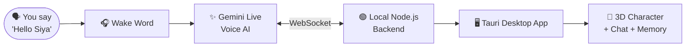

 

[🌐 **Visit Website**](https://shinchanssg.github.io/Siya-AI/) &nbsp;•&nbsp; [💬 **Join Discord**](https://discord.gg/P9ksdwqpH) &nbsp;•&nbsp; [👤 **Meet the Developer**](#-the-developer)

## 🌸 Who is SIYA?

> *"Just say **Hello Siya** and she's with you."*

**SIYA** is my personal AI assistant, a voice-first companion that listens, remembers, and helps you control your PC. She lives in a desktop app with a **3D character stage**, so she's not just a chatbox, she's a presence on your screen.

> [!WARNING]
> **SIYA is not officially released yet.** She's under active development, so expect rough edges. Stay tuned! 🚀

## ✨ Features

<table>
<tr>
<td width="50%" valign="top">

### 🎙️ Voice First
Talk to SIYA naturally using **Gemini Live** voice. Wake her up with the wake word **"Hello Siya"**.

</td>
<td width="50%" valign="top">

### 🧠 Memory
SIYA remembers things for you. Memory is stored **locally**, with a **dashboard** where you can view it.

</td>
</tr>
<tr>
<td width="50%" valign="top">

### 🖥️ Desktop Control
Say *"I'm going to sleep"* and SIYA can **shut down or sleep your PC** for you.

</td>
<td width="50%" valign="top">

### 👀 Screen Awareness
Been on screen for **30+ minutes**? SIYA gently tells you to **take a break**. 💜

</td>
</tr>
<tr>
<td width="50%" valign="top">

### 🧍 3D Character Stage
A live 3D stage with **camera view controls** and a **desktop companion** mode.

</td>
<td width="50%" valign="top">

### 🧩 Bring Your Own Model
No model is bundled. Add your own **`.pmx`** or **`.zip`** character and make SIYA yours.

</td>
</tr>
</table>

**In the app menu:** `Topics` · `Recall` · `Share screen` · `Gemini model picker` · `Settings`

## ⚙️ How It Works

## 🧰 Tech Stack

| Layer | Tech |
|:---:|:---|
| 🖥️ Desktop App | **Tauri** |
| 🟢 Backend | **Node.js** (runs locally) |
| 🔌 Realtime | **WebSocket** |
| 🎙️ Voice / AI | **Gemini Live** |
| 🧠 Memory | **localStorage** + dashboard |

## 📋 What You'll Need

- 🔑 Your own **Gemini API key** (SIYA doesn't ship with one)
- 🧍 Your own **3D model** in `.pmx` or `.zip` format

## 🗺️ Roadmap

- [x] Voice interaction with Gemini Live
- [x] Wake word: "Hello Siya"
- [x] Local memory + dashboard
- [x] Desktop integration (sleep / shutdown by voice)
- [x] Screen awareness break reminders
- [ ] 🔭 **SIYA Cross Device Control (SCDC)** *(future idea)*
- [ ] 🚀 Official release

## 🌐 Website

SIYA has her own animated promo website:

## 🛠️ Website Banwana Hai? (Website Request)

Apne **channel**, **project** ya **business** ke liye website chahiye?
Discord server join karo aur apni **website banane ki request** bhejo.

**Request kaise bhejein?**

1. 🎮 Discord server join karo: https://discord.gg/P9ksdwqpH
2. 📩 Website request wale channel mein jao
3. ✍️ Batao kaisi website chahiye, aur apne reference links ya ideas share karo

## 👤 The Developer

### **Shravan Ghogare** *(Shravan SG)*
*Creator of SIYA AI*

⭐ **Agar SIYA pasand aayi to repo ko star zaroor karna!** ⭐

**Created by Shravan SG** &nbsp;•&nbsp; *Your AI, Your World.* 💜

